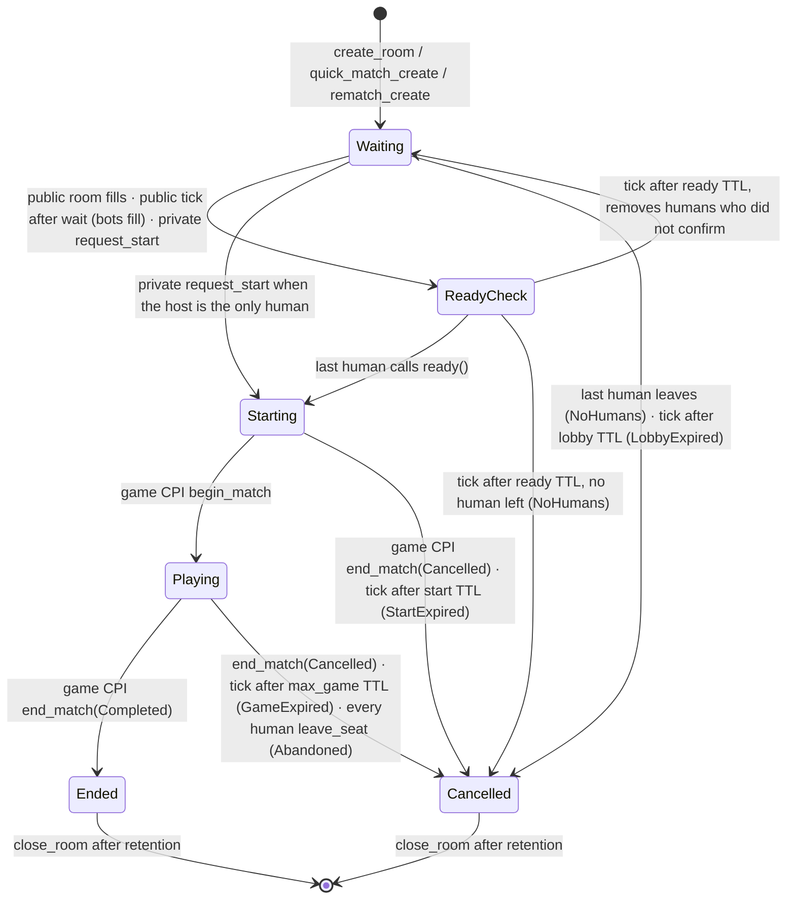

# Lobby Integration Guide

> Program `lobby` · IDL **0.1.0** (frozen) · Anchor 1.2.1 · **devnet** `5zdBSvep3yV6v1SVD67uw9N5Wb3eT9Hp9D3eg4YSRqRu`
> Source of truth: `idls/lobby.json` and `programs/lobby/src/`. If this guide and the IDL disagree, the IDL wins. Please report the mismatch.

## 0. Mental model

- **One lobby program serves every game.** Each game gets its own `LobbyConfig` and `Matchmaker`, and its rooms are keyed by `(game_program, room_id)`.
- **The game is registered in platform-core first.** That registration gives the game a `GameEntry` PDA with an `owner` and a `game_authority`: the game's PDA signer, seed `[b"game_authority"]` under the game program. Lobby trusts only that registration.
- **The game calls lobby; lobby never calls the game.** Lobby can still cancel a room on its own when a deadline passes, so a game must check the room's phase rather than wait to be told (§5.3).
- **No timers on chain.** Every waiting phase stores an anchor timestamp and a TTL. Once the deadline passes, anyone may call `tick` to apply it. Until then, normal actions still work, so a late `ready()` that lands before the `tick` still counts.
- **One player, one room, hub-wide.** Each player has one `PlayerClaim` PDA (`[b"claim", player]`). It is never "released": a claim is *live* only while the room it points at exists, isn't finished, and still seats that player as an active human. Leaving, being kicked, the room ending or the room being closed all free the player automatically.
- **Whoever creates an account pays its rent, and gets it back on close.** The payer is stored as `rent_payer` and is the only address a close can refund. A gasless relayer may act as the payer (§7).

## 1. Accounts and PDAs

| Account | Seeds (program = lobby) | Created by | Size | Notes |
|---|---|---|---|---|
| `LobbyConfig` | `[b"lobby_config", game_program]` | `init_lobby` (game owner) | 109 B | Per-game rules. `update_config` affects **new** rooms only. |
| `Matchmaker` | `[b"matchmaker", game_program]` | `init_lobby` | 43 B | `next_room_id` starts at 1 and is never reused. `open_public_room` is the quick-match pointer. Never closed. |
| `Room` | `[b"room", game_program, room_id.to_le_bytes()]` | `create_room` / `quick_match_create` / `rematch_create` | `211 + 35 × max_seats` B (351 B at 4 seats, 491 B at 8) | Snapshot of the config taken at creation. |
| `PlayerClaim` | `[b"claim", player]` | `init_claim` | 188 B | One per player across **all** games. |
| `GameEntry` (platform-core) | `[b"game", game_program]` under platform-core | platform-core | — | Must be `Active` to create rooms. |

```ts
// @solana/kit — the same derivation the Lobby Worker uses
import { address, getProgramDerivedAddress, getAddressEncoder, getU64Encoder } from '@solana/kit';
const LOBBY = address('5zdBSvep3yV6v1SVD67uw9N5Wb3eT9Hp9D3eg4YSRqRu');
const enc = getAddressEncoder();
const roomPda = async (game: string, roomId: bigint) =>
  (await getProgramDerivedAddress({ programAddress: LOBBY, seeds: ['room', enc.encode(address(game)), getU64Encoder().encode(roomId)] }))[0];
const claimPda = async (player: string) =>
  (await getProgramDerivedAddress({ programAddress: LOBBY, seeds: ['claim', enc.encode(address(player))] }))[0];
const matchmakerPda = async (game: string) =>
  (await getProgramDerivedAddress({ programAddress: LOBBY, seeds: ['matchmaker', enc.encode(address(game))] }))[0];
```

### Room fields that matter to clients

`phase` · `end_reason` · `is_public` · `host: Option<Pubkey>` · `seats: Vec<Seat>` (length = `max_seats` for the room's whole life; seats are never re-packed) · `rematch_room_id: Option<u64>` · `ttl` (the room's snapshot of the config TTLs) · `phase_since` · `last_human_activity_at` · `rent_payer`.

`Seat = { kind: Empty | Human | Bot, player, ready, left }`. An *active human* is `kind == Human && !left`.

Raw offsets for `getProgramAccounts` filters are stable only **up to the first `Option`**:
- Room: `phase` @ 82, `rent_payer` @ 10, `game_program` @ 42, and the fixed prefix ends at byte 133.
- PlayerClaim: `player` @ 42, `last_joined_at` @ 74, `current` @ 82.

Decode anything after those offsets with the IDL.

## 2. Phases and deadlines



| Phase | Deadline applied by `tick` | Anchor timestamp |
|---|---|---|
| Waiting | `ttl.lobby` → Cancelled(LobbyExpired). Public rooms with bots allowed: after `ttl.wait`, empty seats fill with bots → ReadyCheck (needs `humans ≥ min_humans`). | `last_human_activity_at` (lobby) · `phase_since` (wait) |
| ReadyCheck | `ttl.ready` → humans who didn't confirm are removed. Public rooms also drop their bots. → back to Waiting, or Cancelled if no human is left. | `phase_since` |
| Starting | `ttl.start` → Cancelled(StartExpired) | `phase_since` |
| Playing | `ttl.max_game` → Cancelled(GameExpired) | `phase_since` |
| Ended / Cancelled | `close_room` becomes possible after `ttl.retention` | `phase_since` |

**Program ceilings on game config:**

| Ceiling | Value |
|---|---|
| `ready` | ≤ 120 s |
| `start` | ≤ 300 s |
| `lobby` | ≤ 21 600 s |
| `max_game` | ≤ 86 400 s |
| `retention` | ≤ 86 400 s |
| Seats | `2 ≤ max_seats ≤ 8` |

`InvalidConfig` also rejects:
- any TTL of 0
- `min_humans` not satisfying `1 ≤ min_humans ≤ min_seats ≤ max_seats`
- `wait ≥ lobby`
- `rematch_window < 60`
- `retention < rematch_window`

## 3. Instructions

Caller types:
- **P**: the player signs.
- **H**: the host of a private room signs.
- **A**: anyone may call it.
- **G**: the game's `game_authority` PDA signs via CPI.
- **O**: the game owner (`GameEntry.owner`) signs.

**$** marks the instructions that take a separate `payer` signer and always create an account (rent).

| Instruction | Who | Phase | Effect |
|---|---|---|---|
| `init_lobby(params)` | O | — | Creates the game's `LobbyConfig` and `Matchmaker`. `GameEntry` must be Active. The owner pays with their own wallet. |
| `update_config(params)` | O | — | Updates `LobbyConfig`. Existing rooms keep their snapshot. |
| `init_claim()` $ | P | — | Creates the player's `PlayerClaim`. Done once per player, hub-wide. |
| `create_room()` $ | P | — | New private room; the caller is host in seat 0. Needs `private_enabled`, `GameEntry` Active, and the create cooldown. |
| `join_room()` | P | Waiting | Joins a **private** room in the lowest free seat. A public room → `ModeDisabled`. |
| `quick_match_join()` | P | Waiting | Joins the room in `matchmaker.open_public_room`. If that fills the room → ReadyCheck. |
| `quick_match_create()` $ | P | — | New public room when the pointer is empty. Needs `public_enabled` and the create cooldown. |
| `leave_room()` | P | **Waiting only** | Frees the seat. If the host leaves, the next human becomes host. If the last human leaves → Cancelled. |
| `ready()` | P | ReadyCheck | Confirms. When the last human confirms → Starting. |
| `leave_seat()` | P | Playing | Marks the seat `left`; the game still sees who dropped. If every human leaves → Cancelled(Abandoned). |
| `add_bot(seat)` / `remove_bot(seat)` | H | Waiting | Private rooms only. `add_bot` needs `bot_fill`. |
| `kick_player(seat)` | H | Waiting | Empties the seat. The victim can't rejoin **this room** for 10 s. |
| `request_start()` | H | Waiting | Needs `occupied ≥ min_seats` and `humans ≥ min_humans` → ReadyCheck, with the host already ready. |
| `rematch_join()` | P | old room Ended | Joins the rematch room the old room points at. |
| `rematch_create()` $ | P | old room Ended | Creates the rematch room and points the old room at it. Has the create cooldown. |
| `tick()` | A | any | Applies the first deadline that is due. If nothing is due it is a **successful no-op**. |
| `close_room()` | A | Ended/Cancelled | After `retention`, closes the room and refunds `rent_payer` (who need not sign). |
| `close_claim()` | A | — | Needs the claim idle ≥ **30 days**, not live, and no running kick cooldown. Closes it and refunds `rent_payer`. |
| `begin_match()` | G | Starting | → Playing |
| `end_match(result)` | G | Playing (Completed or Cancelled) · Starting (Cancelled only) | → Ended or Cancelled(GameCancelled) |

**Limits:**

| Limit | Value |
|---|---|
| Create cooldown | 60 s per player, across all three create instructions |
| Kick cooldown | 10 s |
| Claim idle before `close_claim` | 30 days |
| Max seats | 8 |

### 3.1 Account lists (order = IDL order)

Mark `?` = optional. When you don't use an optional account, **pass the lobby program ID** in its slot, read-only. Never drop the slot: later accounts would shift into it.

```
init_claim          player(s) · payer(s,w) · claim(w) · system_program
create_room         player(s) · payer(s,w) · game_entry · config · matchmaker(w) · claim(w) · prev_room? · new_room(w) · system_program
quick_match_create  player(s) · payer(s,w) · game_entry · config · matchmaker(w) · claim(w) · prev_room? · new_room(w) · system_program
quick_match_join    player(s) · matchmaker(w) · room(w) · claim(w) · prev_room?
join_room           player(s) · room(w) · claim(w) · prev_room?
leave_room          player(s) · room(w) · matchmaker?(w)        ← required for public rooms
ready               player(s) · room(w)
leave_seat          player(s) · room(w)
add_bot / remove_bot / request_start   host(s) · room(w)
kick_player         host(s) · room(w) · victim_claim(w)          ← claim PDA of the player in `seat`
rematch_join        player(s) · old_room · claim(w) · prev_room? · rematch_room(w)
rematch_create      player(s) · payer(s,w) · game_entry · config · matchmaker(w) · old_room(w) · claim(w) · prev_room? · rematch_room? · new_room(w) · system_program
tick                room(w) · matchmaker?(w)                     ← matchmaker for public rooms in Waiting / ReadyCheck
close_room          room(w) · rent_payer(w)
close_claim         claim(w) · rent_payer(w) · prev_room?
begin_match / end_match   room(w) · game_entry · game_authority(s)
init_lobby          owner(s,w) · game_program · game_entry · config(w) · matchmaker(w) · system_program
update_config       owner(s) · game_entry · config(w)
```

- **`prev_room`** is the room PDA that `claim.current` points at. Pass it whenever `claim.current` is `Some`, even when it is the room you are entering, or the old room in a rematch. Pass the program ID when `claim.current` is `None`. Lobby reads it to decide whether the claim is still live.
- **`new_room`** is `roomPda(game, matchmaker.next_room_id)`. Read the Matchmaker just before you build the tx.
- **`rematch_room` in `rematch_create`** is the room PDA of `old_room.rematch_room_id` when that is `Some`. Pass the program ID when it is `None`.

## 4. Frontend recipes

**First action of a new player.** If the claim account doesn't exist yet, send `[init_claim, <enter-room ix>]` in **one** transaction. A claim that already exists makes `init_claim` fail, so send it only when the claim is missing.

**Private room:** `create_room`. Share the `room_id` (from the `RoomCreated` event or the Matchmaker counter). Friends call `join_room`. The host calls `request_start`, and everyone calls `ready()`.

**Quick match:**
```
read Matchmaker
  open_public_room = Some(id) → quick_match_join(room = roomPda(game, id))
  None                        → quick_match_create(new_room = roomPda(game, next_room_id))
on 6000 StaleMatchmaker → re-read the Matchmaker and rebuild (another player moved first)
```

**Rematch** (old room is `Ended`, inside `ttl.rematch_window`):
```
old_room.rematch_room_id = Some(id) → rematch_join(rematch_room = roomPda(game, id))
None                                → rematch_create
on 6001 StaleRematch → re-read old_room: join the new pointer, or create if that room is no longer joinable
```

**Resume after reload:** there is no instruction for this. Read `PlayerClaim`. If `current` is `Some`, read that Room and run the liveness check client-side: the room exists, its phase is not terminal, and the player is in a seat with `Human && !left`.

**Deadlines:** show countdowns using the deadline formulas in §2. When a deadline passes, any client in the room may send `tick()`. The Lobby Worker also sweeps every minute, so this is a UX improvement and not a requirement. Remember that `Clock` on chain can drift a few seconds from wall time.

**Ready-timeout griefing (accepted risk):** a player removed by the ready timeout can quick-match straight back into the same room. Frontends should disable quick match for **60 s** after the player sees their own `SeatChanged { cause: ReadyTimeout }`.

## 5. Game integration (CPI)

### 5.1 Prerequisites
1. Register the game program in platform-core. This sets `GameEntry.owner` and `game_authority`, the game's PDA from seed `[b"game_authority"]`.
2. The owner calls `init_lobby(params)` once.
3. Copy `idls/lobby.json` into your program and use `declare_program!(lobby)` (Anchor 1.2.1).

### 5.2 Begin and end a match

```rust
declare_program!(lobby);
pub const GAME_AUTHORITY_SEED: &[u8] = b"game_authority";

// inside your start-game instruction (room is in Starting):
let seeds: &[&[&[u8]]] = &[&[GAME_AUTHORITY_SEED, &[ctx.bumps.game_authority]]];
lobby::cpi::begin_match(CpiContext::new_with_signer(
    ctx.accounts.lobby_program.key(),
    lobby::cpi::accounts::BeginMatch {
        room: ctx.accounts.room.to_account_info(),               // writable
        game_entry: ctx.accounts.game_entry.to_account_info(),   // platform-core GameEntry of THIS game
        game_authority: ctx.accounts.game_authority.to_account_info(),
    },
    seeds,
))?;
// end: lobby::cpi::end_match(ctx, lobby::types::MatchResult::Completed | Cancelled)
```

A complete, tested example lives in `tests/mock-game/src/lib.rs`. It is test-only; never deploy it. Read the roster from `room.seats` in the same transaction as `begin_match`.

### 5.3 Rules every game must follow
1. **Every move instruction takes the `Room` read-only, requires `room.phase == Playing`, and binds the room to the match:** `require!(room.game_program == crate::ID && room.room_id == match.room_id)`.
   - `Account<lobby::Room>` checks only owner and discriminator. Without the binding, anyone could pass another match's Playing room.
   - If you compare PDAs instead, derive under `lobby::ID` (`seeds::program = lobby::ID`).
2. **Lobby can cancel a room without calling you.** That happens through `tick` (StartExpired or GameExpired) or when every human calls `leave_seat`. Rule 1 is how your game notices.
3. **Don't rely on the `Room` after `retention`**, because anyone can close it then. Settle in the same transaction as `end_match` where you can.
4. **Errors that come back through CPI:**

   | Error | Meaning | Action |
   |---|---|---|
   | 6010 `WrongPhase` | Lobby rejected the call for the room's phase | Never mark retryable in your relayer registration |
   | 6026 `BadGameAuthority` | Lobby rejected the signer | Never mark retryable |
   | 3012 | The room is already closed, so the failure is final | Never retry |
   | Anchor 2xxx / 3xxx | Your game passed the wrong accounts | Fix the call |

   Give your own errors an offset so they don't collide with lobby's 6000–6033: `#[error_code(offset = 6100)]`.
5. Bots in hidden-information games are played by the game's own off-chain dealer, so lobby makes no assumption about who moves for a bot.

## 6. Errors

Anchor custom errors 6000–6033. They are append-only, so the numbers never change.

**Retryable races.** Re-read the state and rebuild the transaction.

| Code | Name | Cause |
|---|---|---|
| 6000 | `StaleMatchmaker` | Another player changed the pointer or counter first |
| 6001 | `StaleRematch` | The rematch pointer changed, or the rematch room isn't joinable. From `rematch_create` it can also mean the proof room wasn't passed. |
| 6002 | `RoomFull` | Room is full |
| 6003 | `NotWaiting` | Room is no longer in Waiting |
| 3012 | Anchor `AccountNotInitialized` | The room was closed meanwhile, **or** the player has no claim. In the second case, send `init_claim` first. |

**Not retryable:**

| Code | Name | Code | Name | Code | Name |
|---|---|---|---|---|---|
| 6004 | PrevRoomRequired | 6014 | NotAHuman | 6024 | MatchmakerRequired |
| 6005 | PrevRoomMismatch | 6015 | CannotKickSelf | 6025 | RetentionNotReached |
| 6006 | ClaimLive | 6016 | SeatNotEmpty | 6026 | BadGameAuthority |
| 6007 | AlreadyInRoom | 6017 | SeatNotBot | 6027 | InvalidConfig |
| 6008 | GameNotActive | 6018 | BotsDisabled | 6028 | NotGameOwner |
| 6009 | ModeDisabled | 6019 | KickCooldown | 6029 | InvalidSeat |
| 6010 | WrongPhase | 6020 | NotEnoughSeats | 6030 | MathOverflow |
| 6011 | NotInRoom | 6021 | NotEnoughHumans | 6031 | WrongRoom |
| 6012 | NotHost | 6022 | RematchClosed | 6032 | ClaimNotIdle |
| 6013 | PublicNoHostControl | 6023 | NotInRoster | 6033 | CreateCooldown |

## 7. Rent, the relayer and cranks

- **Rent on devnet** is `(128 + bytes) × 5 080` lamports:

  | Account | Size | Rent (lamports) |
  |---|---|---|
  | PlayerClaim | 188 B | 1 605 280 |
  | Room, 4 seats | 351 B | 2 433 320 |
  | Room, 8 seats | 491 B | 3 144 520 |

- Every close refunds the stored `rent_payer`, and only that address. `rent_payer` is written once when the account is created.
- **Gasless relayer:**
  - Only the four $ instructions take a payer slot, at index 1.
  - Every other instruction can still be fee-sponsored.
  - When sending `tick` through the relayer, append the user as a trailing **read-only signer**. `tick` ignores `remaining_accounts`.
  - Registration values are in `specs/designs/06-relayer-registration.md`: discriminators, account counts, `max_rent_lamports`, CU samples (max about 38k, so no ComputeBudget instruction is needed) and retryable codes.
  - The relayer's rent budget is **not** refunded when an account closes. That is why the program has the create cooldown and the 30-day `close_claim` rule.
- **Lobby Worker** (`worker/`) runs on its own fee-only wallet, which has no privilege in the program:
  - `tick` every minute
  - `close_room` every 10 minutes
  - `close_claim` hourly

  It simulates each transaction first and sends only when the transaction changes state. Anyone else may run the same cranks.

## 8. Events (for indexers)

All events are emitted with `emit!`, which writes `Program data:` logs:

| Event | When |
|---|---|
| `LobbyInitialized` · `LobbyConfigUpdated` | Game owner sets up or changes the config |
| `ClaimCreated` · `ClaimClosed` | A claim is created or closed |
| `RoomCreated { room_id, is_public, host, rent_payer, rematch_of }` | A room is created |
| `SeatChanged { seat, kind, player, cause }` | A seat changes. `cause` is Join, Leave, Kick, AddBot, RemoveBot, ReadyTimeout, Backfill or Purge, and the event carries the post-state. |
| `PlayerReady` · `PlayerLeftSeat` · `HostChanged` | Player confirms, leaves during play, or the host changes |
| `PhaseChanged { from, to, end_reason }` | Every phase transition. Any state change made by `tick` emits at least one event. |
| `MatchmakerPointer { open_public_room }` | The quick-match pointer changes |
| `RoomClosed { refunded_to, lamports }` | A room is closed and its rent refunded |

Events carry no TTLs. Read them from the `Room` account.

## 9. Checklist

- [ ] Game registered in platform-core and `init_lobby` called by the owner
- [ ] `declare_program!(lobby)` built from `idls/lobby.json` 0.1.0
- [ ] Every move instruction checks `Playing` and binds `Room` to the match (§5.3)
- [ ] Game error codes offset above 6033
- [ ] Frontend:
  - [ ] always passes `prev_room`, with the program ID placeholder when there is none
  - [ ] uses `[init_claim, …]` for new players
  - [ ] retries 6000–6003 and 3012 after re-reading state
- [ ] Frontend shows countdowns and sends `tick` when a deadline passes, with the user as trailing read-only signer if relayed
- [ ] Frontend disables quick match for 60 s after the player is removed by ReadyTimeout
- [ ] Relayer registration copied from `06-relayer-registration.md`
